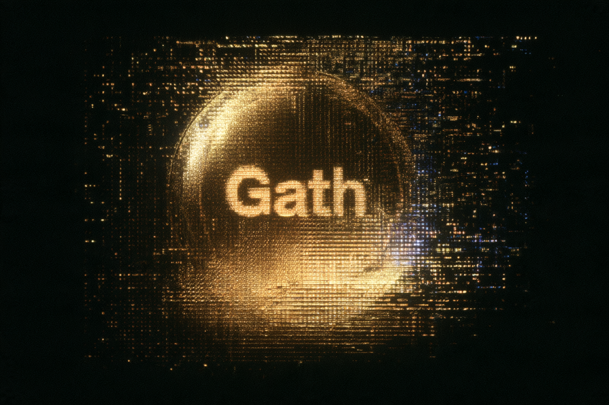

<p align="center">
  <picture>
    <source media="(prefers-reduced-motion: reduce)" srcset="docs/banner.png">
    <source srcset="docs/banner.webp" type="image/webp">
    
  </picture>
</p>

<p align="center">
  
</p>

Gath is a proof-of-work currency. This repository is the full node, the CPU miner, and the command-line wallet. The chain moves one asset, Gath. There is no issuer and no admin key.

The mainnet parameters are in the binary. A public seed is reachable at `104.207.90.38:9733`. It started at genesis and may have few or no peers. There is no DNS name for it yet.

The website is at https://gath-org.github.io/gath/.

<p align="center">
  
</p>

## Install

Go 1.24 or newer.

```bash
git clone https://github.com/gath-org/gath.git
cd gath
go build -o bin/gath ./cmd/gath
```

`make build` writes `bin/gath`. From a published commit:

```bash
go install github.com/gath-org/gath/cmd/gath@latest
```

## Node

These commands start a node on this machine. A mainnet node listens for peers from the internet and dials the public seed.

### Mainnet

A mainnet node dials the public seed on startup. `--datadir` is required:

```bash
bin/gath node --network mainnet --datadir ./mainnet-data
```

The seed is `104.207.90.38:9733`, listed in `MainnetBootnodes` in `internal/p2p/seeds.go`. `MainnetDNSSeeds` is empty. The seed started at genesis. It may have few or no peers. There is no DNS name for it yet.

Peers listen on all interfaces, port 9733. `--listen` defaults to `0.0.0.0:9733`. Override that with `--listen`. Allow TCP 9733 through the host firewall, and forward that port if the machine is behind NAT. Set `--external <public-host>:9733` to an address other people can dial. The node then tells peers that address. Without `--external` it still accepts inbound connections, and it does not advertise `0.0.0.0` or `::`.

The JSON API listens on `127.0.0.1:9734`. It has no authentication, so it must stay on localhost. A caller who can reach it can read the chain, submit transactions, and ask this process to mine. Do not forward 9734, and do not set `--rpc` to a public address.

`--connect` is repeatable. It adds a known peer, including the seed:

```bash
bin/gath node --network mainnet --datadir ./mainnet-data --connect 104.207.90.38:9733
```

### Devnet

Devnet stays on this machine. It listens on `127.0.0.1:19733` for peers and `127.0.0.1:19734` for the API. It does not dial mainnet seeds.

```bash
bin/gath node --network devnet --datadir ./data
bin/gath node --network devnet --datadir ./data --connect 127.0.0.1:19743
```

`--mine --mine-to <address>` mines in this process and pays the block reward to that address. Use a `gath` address on mainnet and a `gathd` address on devnet.

## Miner

`gath miner` takes a template from a node, hashes it, and submits the block. It does not hold wallet keys.

```bash
bin/gath miner --rpc http://127.0.0.1:19734 --address <address> --blocks 1
```

The default RPC is `http://127.0.0.1:9734`. `--blocks` accepts 1 through 500.

## Wallet

The recovery phrase is a BIP39 mnemonic. The words alone restore the wallet. The passphrase only encrypts the wallet file on this machine. It must be at least 8 characters. Pass it with `--passphrase` or `GATH_WALLET_PASSPHRASE`, or type it at the prompt.

Mainnet addresses start with `gath`. Devnet addresses start with `gathd`. The wallet default is mainnet.

```bash
export GATH_WALLET_PASSPHRASE='choose-a-passphrase'
bin/gath wallet create --network mainnet --file wallet.json
bin/gath wallet address --file wallet.json
bin/gath wallet balance --file wallet.json --rpc http://127.0.0.1:9734
bin/gath wallet send --file wallet.json --rpc http://127.0.0.1:9734 --to <gath-address> --amount 1
```

A devnet wallet only talks to a devnet node:

```bash
bin/gath wallet create --network devnet --file wallet-dev.json
bin/gath wallet balance --file wallet-dev.json --rpc http://127.0.0.1:19734
```

`send` returns when the node has accepted the transaction into its mempool. Amounts are decimal Gath: `1` is one Gath, `0.00000001` is one atom. A block reward can be spent after 100 blocks.

`wallet.json` is gitignored. Do not commit it.

## Devnet

`make devnet` builds the binary, starts three nodes, mines, and sends Gath from one wallet to another and back. Data stays in `devnet-data/`, which is gitignored.

## Parameters

| | Mainnet | Devnet |
| --- | --- | --- |
| Address prefix | `gath` | `gathd` |
| Peer port | 9733 | 19733 |
| API port | 9734 | 19734 |
| Proof-of-work limit | `0x1d200000` | `0x207fffff` |
| Genesis time | 2026-11-10 00:00:00 UTC | 2026-11-10 00:00:00 UTC |
| Genesis hash | `000000188a984787dd0fe04e28cfaf3a5e18a1e79ecfd465c4b20cc5d47b05cb` | `4c4f05bb3eb2455bbccff0d3573aa2ced4ba2169f2e6986c67f647e43ec581f4` |

Proof of work is SHA3-256 of the 88-byte header. The target interval is 45 seconds. Difficulty is relative ASERT with a half-life of 12,960 seconds. The subsidy starts at 5 Gath and halves every 2,100,000 blocks. The sum of that schedule is 20,999,999.727 Gath. Genesis pays nothing.

Signatures are ML-DSA-44. Addresses are bech32m.

The rules are in [docs/consensus.md](docs/consensus.md). What this milestone includes, and what it leaves open, is in [docs/milestone-1.md](docs/milestone-1.md).

## Test

```bash
make test
make lint
```

`go test ./...` includes a three-node test that mines, pays, partitions the network, and reorgs.

## License

[MIT](LICENSE). Copyright 2026 Hyperloop, Inc.
